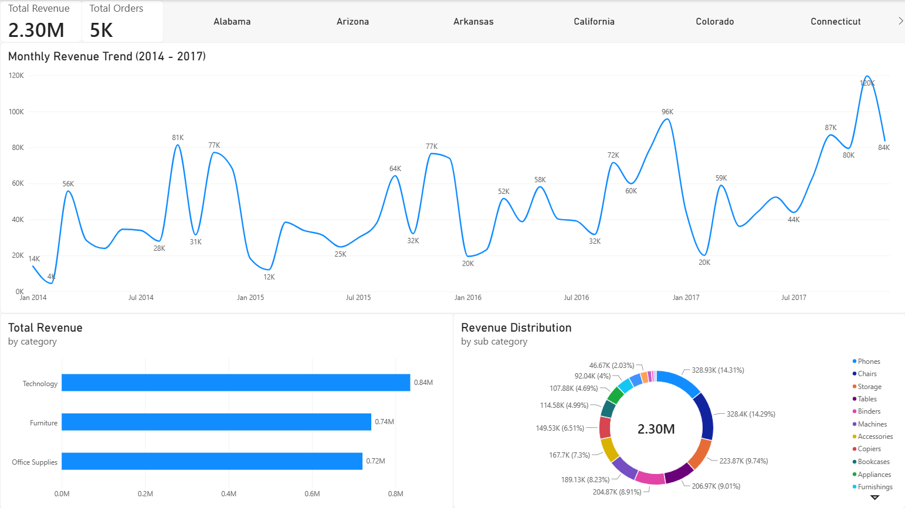
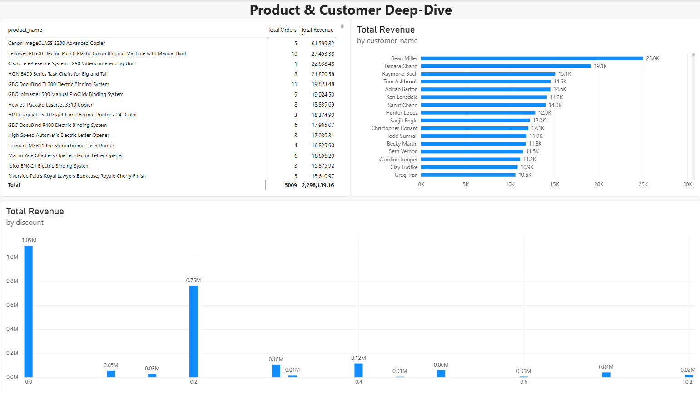

# Executive Power BI Dashboard & Operational KPI Suite

An interactive, multi-page executive operational intelligence dashboard built in Power BI, connected to a normalized relational PostgreSQL star-schema. Designed to provide executive stakeholders with instant macro-level visibility into financial revenue health, product sales velocity, and discounting efficiency.

---

## 📊 Dashboard Architecture & Page Breakdown

### Page 1: Executive Overview
* **Purpose:** A high-level financial health check for executive leadership.
* **Key Metrics & Components:**
  * **Global Slicer Header:** Dynamic filtering by state and geographic region.
  * **Macro KPI Cards:** Total Revenue ($2.30M) and Total Orders (5K unique transactions).
  * **Hero Time-Series Trend Line:** Continuous monthly revenue tracking (2014–2017) highlighting seasonal holiday spikes.
  * **Category Revenue Breakdown:** Explicit revenue distribution across **Technology** ($0.84M), **Furniture** ($0.74M), and **Office Supplies** ($0.72M).

### Page 2: Product & Customer Deep-Dive
* **Purpose:** Granular inventory and customer tier investigation for category managers.
* **Key Metrics & Components:**
  * **Flagship Accounts & Products:** Highlights top-tier clients such as *Sean Miller* ($25K total spend) and top-earning inventory items like the *Canon imageCLASS 2200 Advanced Copier* ($61,599.82).
  * **Discount Efficiency Analysis:** Proves that revenue is heavily concentrated in zero-discount ($1.09M) and 20% discount ($0.76M) brackets, while cumulative heavy discounting exceeding 30% yields diminishing returns ($0.37M total).

---

## 🛠️ Technical Implementation & DAX Modeling
* **Data Model:** Star-schema architecture built from local PostgreSQL tables (`orders`, `products`, `customers`) with enforced primary and foreign keys.
* **Core DAX Formulas:**
  * **Total Revenue (Row-Level Iteration):**
    ```dax
    Total Revenue = SUMX( orders, orders[quantity] * RELATED( products[unit_price] ) * (1 - orders[discount]) )
    ```
  * **Total Orders (Distinct Counting):**
    ```dax
    Total Orders = DISTINCTCOUNT( orders[order_id] )
    ```

---

## 🚀 Visual Documentation & Deliverables
* **`Superstore_Executive_Overview.pbix`**: Fully interactive source file.
* **`Executive_Overview.pdf`**: Offline executive export.

### Visual Preview
**Executive Overview Page:**


**Product & Customer Deep-Dive Page:**

